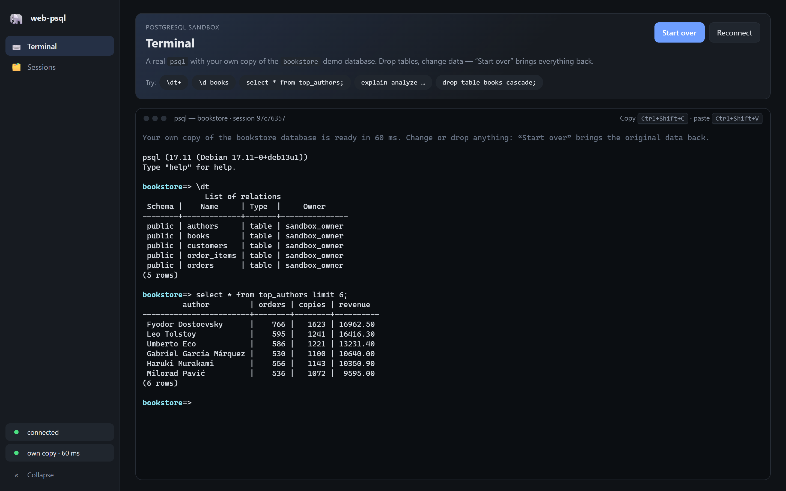
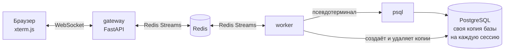
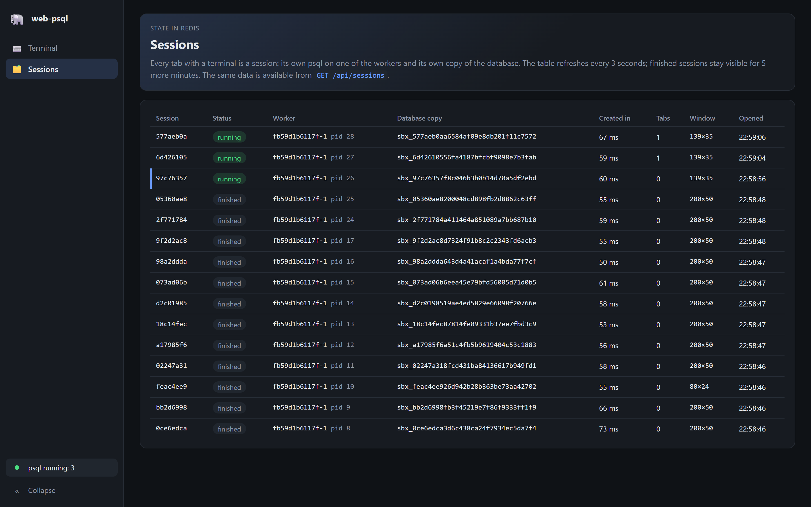
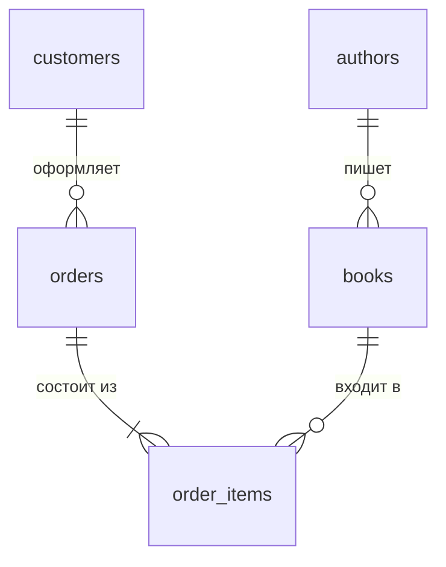

# web-psql

[](https://github.com/ZhdankovAlex/web-psql/actions/workflows/tests.yml)

Терминал PostgreSQL прямо в браузере. Открываете страницу — получаете настоящий `psql`
и **свою личную копию учебной базы**. Её можно ломать как угодно: удалять таблицы,
делать `UPDATE` без `WHERE`, очищать данные. Кнопка «Начать заново» за доли секунды
выдаёт новую копию с исходными данными.

Это не имитация: в браузере работает тот же `psql`, что и в обычном терминале, со всеми его
возможностями — историей команд, автодополнением по Tab, Ctrl+C для отмены запроса,
постраничным просмотром длинных результатов, `\timing`, `\watch`.



## Как запустить

```bash
docker compose up --build
```

Откройте <http://localhost:8000>. Нужен только Docker. Поднимутся четыре контейнера:
PostgreSQL 17, Redis и два сервиса приложения. Учебная база создаётся при первом запуске.

## Возможности

- **У каждой вкладки своя база.** Копия создаётся за 40–60 мс и удаляется, когда сессия
  закрывается. Что именно можно и чего нельзя — в [docs/sandbox.md](docs/sandbox.md).
- **Сломать можно только свою копию.** Пользователь работает не под администратором: он не может
  переключиться на другие базы, запускать программы на сервере через `COPY … PROGRAM`
  или менять настройки сервера. Команды ОС через `\!` выполняются от отдельного пользователя,
  которому не видны пароли.
- **Обрыв связи не страшен.** Если пропала сеть или страницу перезагрузили, psql продолжает
  работать, а браузер дополучает всё, что пропустил.
- **Можно запустить несколько копий сервиса.** Например, `docker compose up --scale worker=3` —
  новые сессии распределятся между ними.
- **Падение сервиса не остаётся незамеченным.** Если процесс с psql упал, браузер узнаёт
  об этом примерно за 12 секунд, а оставшиеся копии баз удаляются автоматически.
- **Страница «Сессии»** показывает все открытые терминалы: где запущен psql, сколько создавалась
  копия базы, сколько вкладок подключено. Те же данные отдаёт `GET /api/sessions`.
- **Примеры запросов** запускаются одним кликом. Копировать — `Ctrl+Shift+C`, вставить —
  `Ctrl+Shift+V`: обычный `Ctrl+C`, как в любом терминале, отменяет запрос.


## Как это устроено



Приложение состоит из двух сервисов, которые общаются только через Redis:

- **gateway** ([`webpsql/gateway.py`](webpsql/gateway.py)) — веб-сервер на FastAPI. Отдаёт
  страницы и держит WebSocket-соединение с браузером. Проверяет всё, что присылает браузер,
  и передаёт дальше через Redis. Сам psql не запускает.
- **worker** ([`webpsql/worker.py`](webpsql/worker.py)) — создаёт копию базы
  ([`sandbox.py`](webpsql/sandbox.py)) и запускает psql в псевдотерминале — так программа
  думает, что работает в настоящем терминале. Всё, что печатает psql, worker отправляет
  в Redis, а нажатия клавиш из Redis передаёт psql. Входящих подключений worker не принимает:
  он сам подключается к Redis и PostgreSQL, поэтому его можно держать рядом с базой,
  не открывая наружу ни одного порта.
- **Redis Streams** — очереди сообщений, через которые идут ввод, вывод и заявки на новые
  сессии. В Redis же хранятся сведения о сессиях ([`streams.py`](webpsql/streams.py)).

Подробно — как живёт сессия от открытия вкладки до закрытия, какие ключи лежат в Redis,
формат сообщений и настройки: [docs/architecture.md](docs/architecture.md).



## Учебная база

Книжный магазин `bookstore`: 15 авторов, 30 книг, 500 покупателей, 5 000 заказов, около
10 000 позиций в заказах и представление `top_authors`. Данные генерируются одинаково
при каждом запуске.



Столбцы, индексы и что попробовать — [docs/data-model.md](docs/data-model.md).

## Что ограничивает масштаб

Раньше всего закончатся подключения к PostgreSQL. Каждая сессия — это отдельное подключение,
а PostgreSQL по умолчанию принимает не больше 100 подключений. Память и Redis закончатся
гораздо позже.

Ещё два слабых места:

- когда много людей открывают терминал одновременно, копии баз создаются по очереди —
  при 10 одновременных сессиях ожидание вырастает с 50 до ~200 мс;
- если запрос выводит огромный результат, а браузер не успевает его принимать, часть вывода
  может потеряться: сервер не притормаживает psql, а хранит только последние 2 000 кусков вывода.

Замеры и как это можно исправить — [docs/bottlenecks.md](docs/bottlenecks.md).

## Тесты

```bash
pip install -r requirements-dev.txt
ruff check .                     # линтер, правила в pyproject.toml
python -m pytest tests/unit      # быстрые тесты, Docker не нужен
docker compose up --build --detach --wait
python -m pytest tests/stand     # тесты на запущенном стенде
```

**Быстрые тесты** (около секунды) проверяют сервер без Docker: Redis заменён на
fakeredis. Покрыто: какие сообщения WebSocket пропускаются и какие отсеиваются, HTTP API,
заявка на новую сессию, переподключение с получением только пропущенного вывода,
защита от подстановки лишнего в имена баз.

**Тесты на стенде** подключаются к настоящему терминалу через WebSocket — как вкладка
браузера — и проверяют то, ради чего проект сделан:

- у сессии своя копия базы, и запрос в ней выполняется;
- удалённая таблица не пропадает у следующей сессии;
- после закрытия сессия помечается завершённой;
- `\c postgres`, удаление шаблона, `COPY … PROGRAM`, `ALTER SYSTEM`, `CREATE DATABASE` запрещены;
- `\!` работает от пользователя `sandbox`, паролей в окружении нет;
- после обрыва связи приходит только пропущенный вывод;
- неправильное сообщение отклоняется, а сессия продолжает работать.

Если стенд не запущен, эти тесты пропускаются.

Оба набора запускаются на каждый push и pull request в GitHub Actions
([`.github/workflows/tests.yml`](.github/workflows/tests.yml)). Сначала линтер и быстрые
тесты, затем, если они прошли, весь стенд поднимается в `docker compose` и проверяется
тестами на стенде. В CI пропуск запрещён: если стенд не поднялся, прогон падает и выводит
логи контейнеров.

## Что где лежит

```
webpsql/
  gateway.py     веб-сервер: страницы, WebSocket /ws, /api/sessions
  worker.py      запуск psql в псевдотерминале, обмен через Redis, уборка забытых копий
  sandbox.py     создание и удаление копии базы и пользователя для сессии
  protocol.py    формат сообщений WebSocket и ответов API
  streams.py     имена ключей Redis, типы сообщений, статусы сессий
  config.py      настройки из переменных окружения
  psqlrc         настройки psql: приглашение bookstore=> вместо служебного имени копии
  static/        страницы «Терминал» и «Сессии»
db/
  init/          подготовка шаблона базы (выполняется при первом запуске PostgreSQL)
  sql/           таблицы и данные учебной базы
tests/
  unit/          быстрые тесты без Docker
  stand/         тесты на запущенном стенде
scripts/
  screenshots.py скриншоты для README
docs/            устройство, песочница, учебная база, ограничения масштаба
```

## Ограничения

Проект рассчитан на запуск у себя. Входа по паролю нет. Команда `\!` в psql открывает
командную строку внутри контейнера — от пользователя без прав и без паролей в окружении,
но с доступом к внутренней сети стенда. Что нужно сделать, прежде чем открывать доступ другим
людям, — в конце [docs/sandbox.md](docs/sandbox.md). Библиотека терминала xterm.js
загружается с CDN jsDelivr, поэтому странице нужен интернет.

## Лицензия

[MIT](LICENSE)
