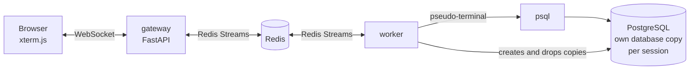
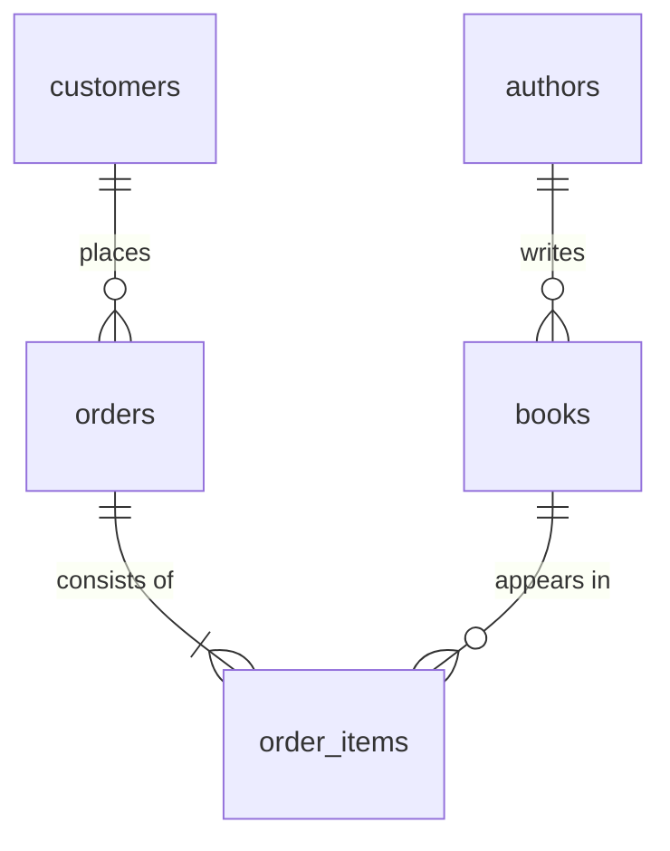

# web-psql

[](https://github.com/ZhdankovAlex/web-psql/actions/workflows/tests.yml)

A PostgreSQL terminal in the browser. Open the page and you get a real `psql` and
**your own copy of a demo database**. Break it any way you like: drop tables, run `UPDATE`
without `WHERE`, wipe the data. The “Start over” button gives you a fresh copy with the
original data in a fraction of a second.

This is not an imitation: the browser runs the same `psql` you use in a regular terminal,
with everything it can do — command history, Tab completion, Ctrl+C to cancel a query,
paging through long results, `\timing`, `\watch`.


## Getting started

```bash
docker compose up --build
```

Open <http://localhost:8000>. All you need is Docker. Four containers start: PostgreSQL 17,
Redis and the two app services. The demo database is created on the first start.

## Features

- **Every tab gets its own database.** The copy is created in 40–60 ms and dropped when the
  session ends. What you can and cannot do is in [docs/sandbox.md](docs/sandbox.md).
- **You can only break your own copy.** The user is not an administrator: they cannot switch
  to other databases, run programs on the server through `COPY … PROGRAM` or change server
  settings. OS commands through `\!` run as a separate user who cannot see any passwords.
- **A dropped connection is not a problem.** If the network drops or the page is reloaded,
  psql keeps running and the browser receives everything it missed.
- **You can run several copies of the service.** For example, `docker compose up --scale worker=3` —
  new sessions are spread between them.
- **A crashed service does not go unnoticed.** If the process running psql crashes, the browser
  finds out in about 12 seconds, and the leftover database copies are removed automatically.
- **The Sessions page** shows every open terminal: where psql runs, how long the database copy
  took to create, how many tabs are connected. `GET /api/sessions` returns the same data.
- **Example queries** run with one click. Copy with `Ctrl+Shift+C`, paste with `Ctrl+Shift+V`:
  plain `Ctrl+C` cancels the query, as in any terminal.


## How it works



The app is two services that talk to each other only through Redis:

- **gateway** ([`webpsql/gateway.py`](webpsql/gateway.py)) — a FastAPI web server. Serves the
  pages and holds the WebSocket connection with the browser. Checks everything the browser sends
  and passes it on through Redis. It never starts psql itself.
- **worker** ([`webpsql/worker.py`](webpsql/worker.py)) — creates the database copy
  ([`sandbox.py`](webpsql/sandbox.py)) and starts psql in a pseudo-terminal, so the program
  believes it runs in a real terminal window. Everything psql prints goes to Redis, and key
  presses from Redis go to psql. The worker accepts no incoming connections: it connects to
  Redis and PostgreSQL itself, so it can sit next to the database without opening a single port.
- **Redis Streams** — message queues that carry input, output and requests for new sessions.
  Redis also keeps the session details ([`streams.py`](webpsql/streams.py)).

In detail — how a session lives from opening the tab to closing it, which keys are in Redis,
the message format and the settings: [docs/architecture.md](docs/architecture.md).


## Demo database

A `bookstore`: 15 authors, 30 books, 500 customers, 5,000 orders, about 10,000 order lines
and a `top_authors` view. The data is generated the same way on every start.



Columns, indexes and things to try: [docs/data-model.md](docs/data-model.md).

## What limits scale

PostgreSQL connections run out first. Every session is a separate connection, and by default
PostgreSQL accepts at most 100. Memory and Redis run out much later.

Two more weak spots:

- when many people open a terminal at once, database copies are created in turn — with 10
  sessions opening together the wait grows from 50 to ~200 ms;
- if a query prints a huge result and the browser cannot keep up, part of the output can be
  lost: the server does not slow psql down, it only keeps the last 2,000 pieces of output.

Measurements and how to fix these: [docs/bottlenecks.md](docs/bottlenecks.md).

## Tests

```bash
pip install -r requirements-dev.txt
ruff check .                     # linter, rules in pyproject.toml
python -m pytest tests/unit      # fast tests, no Docker needed
docker compose up --build --detach --wait
python -m pytest tests/stand     # tests against the running stack
```

**Fast tests** (about a second) check the server without Docker: Redis is replaced with
fakeredis. They cover which WebSocket messages get through and which are rejected, the HTTP
API, filing a request for a new session, reconnecting and getting only the missed output,
and protection against injecting anything into database names.

**Stack tests** connect to a real terminal over WebSocket — the way a browser tab does — and
check what the project is for:

- a session gets its own database copy and a query runs in it;
- a dropped table is still there for the next session;
- after closing, the session is marked as finished;
- `\c postgres`, dropping the template, `COPY … PROGRAM`, `ALTER SYSTEM`, `CREATE DATABASE` are forbidden;
- `\!` runs as the `sandbox` user, with no passwords in the environment;
- after a dropped connection only the missed output arrives;
- an invalid message is rejected and the session keeps working.

If the stack is not running, these tests are skipped.

Both sets run on every push and pull request in GitHub Actions
([`.github/workflows/tests.yml`](.github/workflows/tests.yml)). First the linter and the fast
tests; if they pass, the whole stack starts in `docker compose` and the stack tests run against
it. In CI skipping is not allowed: if the stack did not start, the run fails and prints the
container logs.

## Project layout

```
webpsql/
  gateway.py     web server: pages, WebSocket /ws, /api/sessions
  worker.py      psql in a pseudo-terminal, exchange through Redis, cleanup of forgotten copies
  sandbox.py     creating and dropping the database copy and user for a session
  protocol.py    WebSocket message and API response formats
  streams.py     Redis key names, message types, session statuses
  config.py      settings from environment variables
  psqlrc         psql settings: the bookstore=> prompt instead of the copy's internal name
  static/        the Terminal and Sessions pages
db/
  init/          template preparation (runs on the first PostgreSQL start)
  sql/           demo database tables and data
tests/
  unit/          fast tests without Docker
  stand/         tests against the running stack
scripts/
  screenshots.py README screenshots
docs/            architecture, sandbox, demo database, scaling limits
```

## Limitations

The project is meant to be run on your own machine. There is no login. The `\!` command in
psql opens a shell inside a container — as a user with no privileges and no passwords in its
environment, but with access to the stack's internal network. What to do before letting other
people in is at the end of [docs/sandbox.md](docs/sandbox.md). The xterm.js terminal library
is loaded from the jsDelivr CDN, so the page needs internet access.

## License

[MIT](LICENSE)
