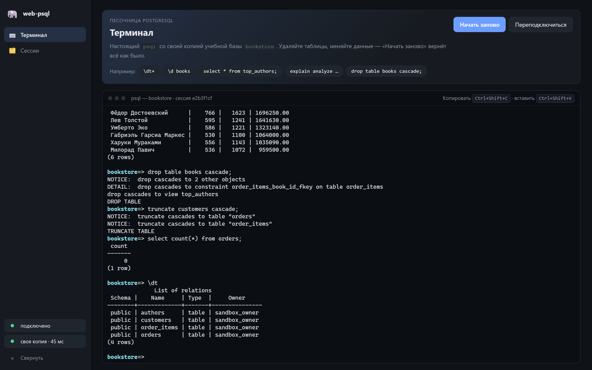
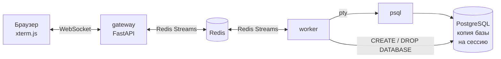
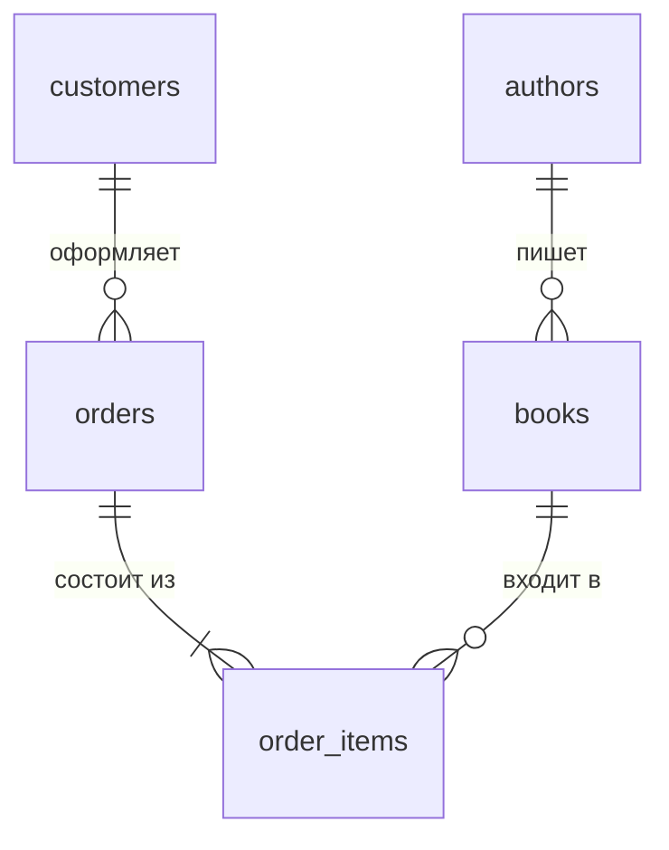

# web-psql

Песочница PostgreSQL в браузере: настоящий `psql` в настоящем терминале и у каждой вкладки —
**своя копия учебной базы**. Удаляйте таблицы, делайте `UPDATE` без `WHERE`, `TRUNCATE … CASCADE` —
«Начать заново» вернёт исходные данные за ~50 мс.

Браузер и psql связаны через WebSocket и Redis Streams, psql работает в псевдотерминале (pty),
поэтому работает всё, что умеет psql: история, автодополнение по Tab, Ctrl+C, пейджер,
`\timing`, `\watch`.


## Быстрый старт

```bash
docker compose up --build
```

Откройте <http://localhost:8000>. Нужен только Docker; поднимутся PostgreSQL 17, Redis,
worker и gateway, учебная база заливается при первом старте.

## Что умеет

- **Своя копия базы на сессию.** `CREATE DATABASE … TEMPLATE` за 40–60 мс, удаляется вместе с сессией.
  Подробности и что проверено — в [docs/sandbox.md](docs/sandbox.md).
- **Ограниченные права.** Роль сессии — не суперпользователь и видит только свою копию:
  `\c postgres`, `COPY … PROGRAM`, `ALTER SYSTEM`, удаление шаблона запрещены.
  `\!` выполняется от отдельного пользователя ОС без доступа к паролям сервера.
- **Переподключение без потерь.** Обрыв сети или перезагрузка страницы — psql продолжает
  работать, браузер получает пропущенный вывод из Redis Stream.
- **Масштабирование.** gateway не хранит состояния, worker'ы делят заявки через consumer group:
  `docker compose up --scale worker=3`.
- **Устойчивость к падению worker'а.** Worker продлевает аренду сессии в Redis; если он упал,
  браузер узнаёт об этом за ~12 секунд, а копии базы подбирает сборщик мусора.
- **Страница «Сессии»** и `GET /api/sessions`: где запущен psql, сколько создавалась копия,
  сколько вкладок подключено.
- **Примеры запросов в один клик**, копирование и вставка — `Ctrl+Shift+C` / `Ctrl+Shift+V`
  (`Ctrl+C` прерывает запрос, как в обычном терминале).



## Как устроено



- **gateway** ([`webpsql/gateway.py`](webpsql/gateway.py)) — страницы, WebSocket, HTTP API.
  Проверяет сообщения браузера Pydantic-моделями ([`protocol.py`](webpsql/protocol.py))
  и перекладывает их в Redis. Терминалов не запускает.
- **worker** ([`webpsql/worker.py`](webpsql/worker.py)) — создаёт копию базы
  ([`sandbox.py`](webpsql/sandbox.py)), запускает psql в pty и читает вывод неблокирующе
  через event loop. Никого не слушает: сам подключается к Redis и PostgreSQL, поэтому его
  можно держать за файрволом рядом с базой.
- **Redis Streams** — ввод, вывод и заявки на сессии; там же сведения о сессиях,
  пульс браузера и аренда worker'а ([`streams.py`](webpsql/streams.py)).

Подробно — ключи Redis, жизнь сессии по шагам, протокол WebSocket, настройки:
[docs/architecture.md](docs/architecture.md).


## Учебная база

Книжный магазин `bookstore`: 15 авторов, 30 книг, 500 покупателей, 5 000 заказов, ~10 000
позиций и представление `top_authors`. Данные генерируются с фиксированным seed.



Столбцы, индексы и что попробовать — [docs/data-model.md](docs/data-model.md).

## Узкие места

Короче всего потолок у PostgreSQL: каждая сессия — отдельный backend и отдельная база,
`max_connections = 100` закончится раньше, чем память или Redis. Дальше — время создания
копии при наплыве (до ~200 мс при 10 одновременных) и отсутствие обратного давления на вывод:
медленный клиент при огромном выводе может пропустить его часть. Замеры и что с этим делать —
[docs/bottlenecks.md](docs/bottlenecks.md).

## Структура

```
webpsql/
  gateway.py     FastAPI: страницы, WebSocket /ws, /api/sessions
  worker.py      pty + psql, Redis Streams, сборщик брошенных копий
  sandbox.py     копия базы и роль на сессию
  protocol.py    модели WebSocket-сообщений и ответов API
  streams.py     ключи Redis, типы сообщений, статусы сессий
  config.py      настройки из переменных окружения
  psqlrc         приглашение bookstore=> вместо имени копии
  static/        страницы «Терминал» и «Сессии»
db/
  init/          шаблон песочницы (выполняется при первом старте PostgreSQL)
  sql/           схема и данные учебной базы
scripts/
  screenshots.py скриншоты для README (Playwright)
docs/            архитектура, песочница, схема данных, узкие места
```

## Ограничения

Это демо для запуска у себя: аутентификации нет, а `\!` в psql даёт shell в контейнере
worker'а (от непривилегированного пользователя и без паролей в окружении, но с доступом к
сети стенда). Что нужно сделать перед публикацией наружу — в конце [docs/sandbox.md](docs/sandbox.md).
Страница загружает xterm.js с CDN jsDelivr.

## Лицензия

[MIT](LICENSE)
