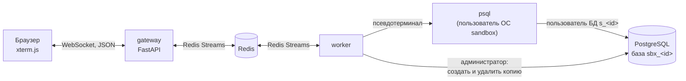
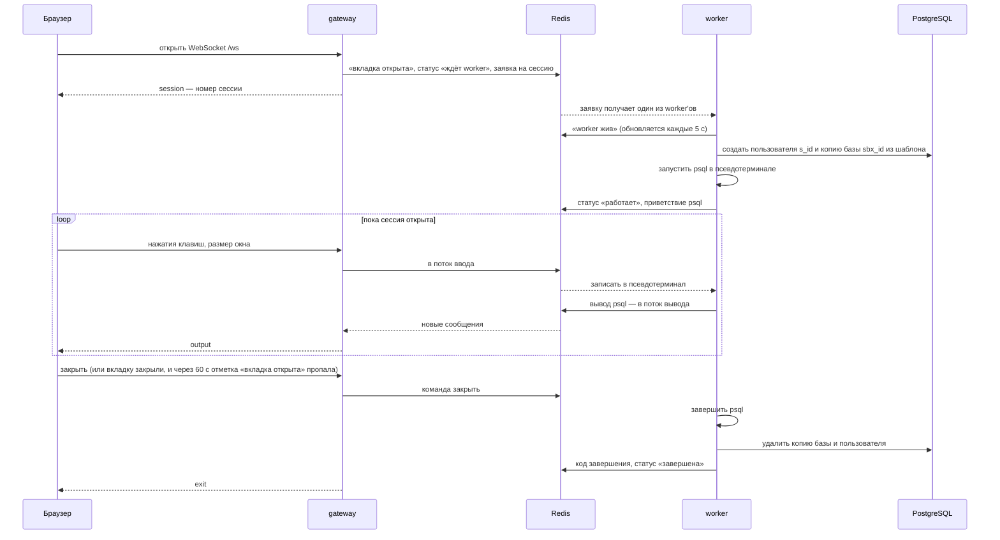

# Как это устроено

| Часть | Код | Что делает |
|---|---|---|
| gateway | [`webpsql/gateway.py`](../webpsql/gateway.py) | Веб-сервер. Отдаёт страницы, держит WebSocket с браузером, проверяет его сообщения по описаниям из [`protocol.py`](../webpsql/protocol.py) и передаёт их через Redis. Сам psql не запускает и ничего не хранит у себя. |
| worker | [`webpsql/worker.py`](../webpsql/worker.py) | Принимает заявки на сессии, создаёт копию базы ([`sandbox.py`](../webpsql/sandbox.py)), запускает psql в псевдотерминале и пересылает данные между psql и Redis. |
| Redis | — | Очереди сообщений между gateway и worker'ами и сведения о сессиях. |
| PostgreSQL | [`db/`](../db/) | Шаблон учебной базы и по одной копии на каждую сессию. |

**Псевдотерминал** (pty) — механизм ОС, благодаря которому программа считает, что работает
в настоящем окне терминала. Без него psql не показал бы приглашение, не поддерживал бы историю
команд, автодополнение, Ctrl+C и постраничный просмотр.

**Redis Streams** — журналы сообщений в Redis: одна сторона дописывает сообщения в конец,
другая читает их по порядку и помнит, на каком остановилась.

Worker сам подключается к Redis и PostgreSQL и не принимает входящих подключений. Его можно
держать рядом с базой, не открывая наружу ни одного порта.

## Что лежит в Redis

| Ключ | Тип | Кто пишет → кто читает | Что внутри |
|---|---|---|---|
| `term:control` | поток | gateway → worker | заявки на новые сессии; каждую получает ровно один worker |
| `term:{id}:in` | поток | gateway → worker | нажатия клавиш, новый размер окна, команда закрыть сессию |
| `term:{id}:out` | поток | worker → gateway | вывод psql, ошибки, код завершения |
| `term:{id}:alive` | строка, живёт 60 с | gateway | «вкладка открыта» — gateway обновляет, пока браузер подключён |
| `term:{id}:owner` | строка, живёт 15 с | worker | «worker жив и держит эту сессию» — worker обновляет каждые 5 с |
| `term:{id}:meta` | хеш | gateway и worker | статус, имя worker'а, номер процесса psql, имя копии базы и время её создания, размер окна, число вкладок |

Типы сообщений и статусы сессий перечислены в [`webpsql/streams.py`](../webpsql/streams.py).

## Как живёт сессия

## Если связь пропала

У каждого куска вывода есть номер — его позиция в потоке Redis. Браузер запоминает номер
сессии и номер последнего полученного куска:

- **пропала сеть** — браузер переподключается и просит вывод начиная со следующего куска;
- **страницу перезагрузили** — экран пустой, поэтому браузер просит весь вывод с начала
  и восстанавливает то, что было на экране;
- **вкладку закрыли** — отметка «вкладка открыта» перестаёт обновляться, и через 60 секунд
  worker завершает psql и удаляет копию базы.

Пока браузер переподключается, psql продолжает работать: начатая транзакция никуда не денется.

## Если worker упал

Worker раз в 5 секунд обновляет отметку «worker жив» для каждой своей сессии, отметка живёт
15 секунд. Если worker упал, через 15 секунд она пропадает:

- gateway замечает это, помечает сессию «потеряна» и сообщает браузеру. Проверено: после
  `docker compose kill worker` браузер узнал об этом через ~12 секунд;
- любой работающий worker раз в минуту (и сразу при запуске) ищет копии баз без такой отметки
  и удаляет их вместе с пользователями.

## Сообщения WebSocket `/ws`

Каждое сообщение — JSON с полем `type`. Для каждого типа в
[`webpsql/protocol.py`](../webpsql/protocol.py) есть описание на Pydantic, и по полю `type`
gateway выбирает, каким описанием проверять сообщение. Сообщение неизвестного типа или
с неправильными полями не проходит дальше, а браузер получает `error` с причиной.

| Кто отправляет | `type` | Поля |
|---|---|---|
| браузер | `input` | `data` — нажатые клавиши или вставленный текст, до 64 КБ |
| браузер | `resize` | `cols`, `rows` — размер окна, от 2 до 1000 |
| браузер | `close` | — |
| сервер | `session` | `id` — номер сессии, `resumed` — подключились ли к уже работающему psql |
| сервер | `output` | `data` — вывод psql, `id` — номер куска в потоке |
| сервер | `error` | `message` |
| сервер | `exit` | `code` — код завершения psql; отрицательный, если psql остановлен сигналом или не запустился |

Новая сессия — `/ws?cols=…&rows=…`. Вернуться к работающей — `/ws?session=<номер>&last=<номер куска>`.
Размер окна браузер отправляет не чаще раза в 200 мс.

## HTTP

Описание в Swagger — <http://localhost:8000/docs>.

| Запрос | Что возвращает |
|---|---|
| `GET /api/sessions` | все сессии, новые сверху; завершённые видны ещё 5 минут |
| `GET /api/sessions/{id}` | одну сессию или `404` |
| `GET /healthz` | `{"redis": true}`, если сервер видит Redis |

## Настройки

| Переменная | По умолчанию | Кто читает | Зачем |
|---|---|---|---|
| `REDIS_URL` | `redis://localhost:6379/0` | оба | адрес Redis |
| `ADMIN_DSN` | `postgresql://postgres@localhost/postgres` | worker | администратор PostgreSQL — создаёт и удаляет копии баз |
| `PG_HOST`, `PG_PORT` | `localhost`, `5432` | worker | куда подключается psql |
| `PSQL_CMD` | `psql` | worker | какую программу запускать в терминале |
| `SANDBOX_USER` | — | worker | от какого пользователя ОС запускать psql; если пусто — от того же, что и worker |
| `SANDBOX_NPROC` | `256` | worker | сколько процессов одновременно может запустить этот пользователь |
| `MAX_SESSIONS` | `10` | worker | сколько терминалов держит один worker |
| `HEARTBEAT_TTL` | `60` | оба | сколько секунд ждать браузер после обрыва связи |
| `STREAM_MAXLEN` | `2000` | worker | сколько последних кусков вывода хранить для переподключения |

Пароли в `docker-compose.yml` берутся из `POSTGRES_PASSWORD` и `REDIS_PASSWORD` (файл `.env`),
по умолчанию — `web-psql`.
