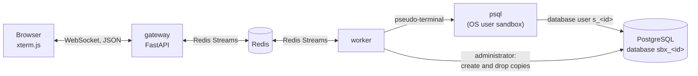
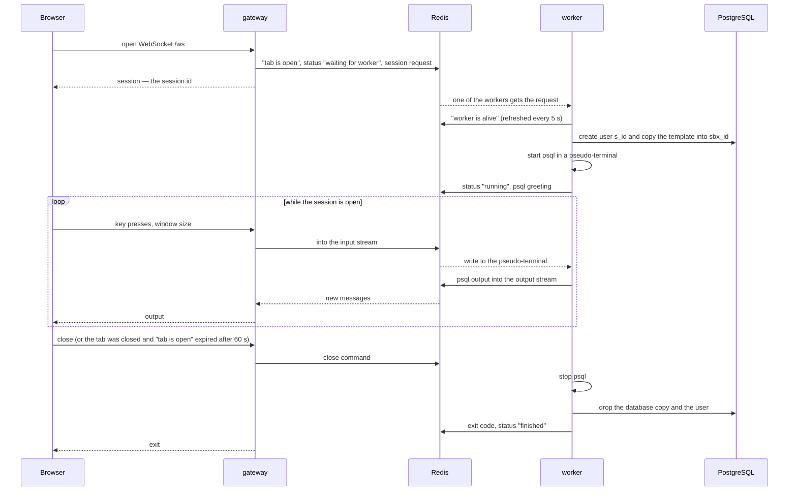

# How it works

| Part | Code | What it does |
|---|---|---|
| gateway | [`webpsql/gateway.py`](../webpsql/gateway.py) | Web server. Serves the pages, holds the WebSocket with the browser, checks its messages against the models in [`protocol.py`](../webpsql/protocol.py) and passes them on through Redis. Never starts psql and keeps nothing in memory. |
| worker | [`webpsql/worker.py`](../webpsql/worker.py) | Takes session requests, creates the database copy ([`sandbox.py`](../webpsql/sandbox.py)), starts psql in a pseudo-terminal and moves data between psql and Redis. |
| Redis | — | Message queues between the gateway and the workers, plus session details. |
| PostgreSQL | [`db/`](../db/) | The demo database template and one copy per session. |

A **pseudo-terminal** (pty) is an OS mechanism that makes a program believe it runs in a real
terminal window. Without it psql would show no prompt and would not support command history,
completion, Ctrl+C or paging.

**Redis Streams** are message logs in Redis: one side appends messages to the end, the other
reads them in order and remembers where it stopped.

The worker connects to Redis and PostgreSQL itself and accepts no incoming connections. It can
sit next to the database without opening a single port.

## What is in Redis

| Key | Type | Who writes → who reads | Contents |
|---|---|---|---|
| `term:control` | stream | gateway → worker | requests for new sessions; each one goes to exactly one worker |
| `term:{id}:in` | stream | gateway → worker | key presses, new window size, the close command |
| `term:{id}:out` | stream | worker → gateway | psql output, errors, exit code |
| `term:{id}:alive` | string, lives 60 s | gateway | "tab is open" — the gateway refreshes it while a browser is connected |
| `term:{id}:owner` | string, lives 15 s | worker | "worker is alive and runs this session" — the worker refreshes it every 5 s |
| `term:{id}:meta` | hash | gateway and worker | status, worker name, psql process id, database copy name and how long it took, window size, number of tabs |

Message types and session statuses are listed in [`webpsql/streams.py`](../webpsql/streams.py).

## Life of a session

## When the connection drops

Every piece of output has a number — its position in the Redis stream. The browser remembers
the session id and the number of the last piece it received:

- **the network dropped** — the browser reconnects and asks for output starting after that piece;
- **the page was reloaded** — the screen is empty, so the browser asks for all output from the
  start and restores what was on the screen;
- **the tab was closed** — the "tab is open" mark stops being refreshed, and after 60 seconds
  the worker stops psql and drops the database copy.

While the browser reconnects, psql keeps running: an open transaction does not go anywhere.

## When a worker crashes

The worker refreshes the "worker is alive" mark for each of its sessions every 5 seconds;
the mark lives 15 seconds. If the worker crashes, the mark disappears 15 seconds later:

- the gateway notices, marks the session "lost" and tells the browser. Tested: after
  `docker compose kill worker` the browser found out in about 12 seconds;
- every running worker looks for database copies without such a mark once a minute (and right
  at startup) and drops them together with their users.

## WebSocket `/ws` messages

Every message is JSON with a `type` field. Each type has a Pydantic model in
[`webpsql/protocol.py`](../webpsql/protocol.py), and the gateway uses `type` to pick the model
that checks the message. A message of an unknown type or with wrong fields goes no further, and
the browser gets an `error` with the reason.

| Sent by | `type` | Fields |
|---|---|---|
| browser | `input` | `data` — key presses or pasted text, up to 64 KB |
| browser | `resize` | `cols`, `rows` — window size, 2 to 1000 |
| browser | `close` | — |
| server | `session` | `id` — session id, `resumed` — whether we reconnected to a running psql |
| server | `output` | `data` — psql output, `id` — position in the stream |
| server | `error` | `message` |
| server | `exit` | `code` — psql exit code; negative if psql was stopped by a signal or never started |

New session — `/ws?cols=…&rows=…`. Back to a running one — `/ws?session=<id>&last=<piece id>`.
The browser sends the window size at most once every 200 ms.

## HTTP

Swagger is at <http://localhost:8000/docs>.

| Request | Returns |
|---|---|
| `GET /api/sessions` | all sessions, newest first; finished ones stay visible for 5 more minutes |
| `GET /api/sessions/{id}` | one session or `404` |
| `GET /healthz` | `{"redis": true}` if the server can reach Redis |

## Settings

| Variable | Default | Read by | Purpose |
|---|---|---|---|
| `REDIS_URL` | `redis://localhost:6379/0` | both | Redis address |
| `ADMIN_DSN` | `postgresql://postgres@localhost/postgres` | worker | PostgreSQL administrator — creates and drops database copies |
| `PG_HOST`, `PG_PORT` | `localhost`, `5432` | worker | where psql connects |
| `PSQL_CMD` | `psql` | worker | which program to run in the terminal |
| `SANDBOX_USER` | — | worker | OS user that runs psql; if empty, the worker's own user |
| `SANDBOX_NPROC` | `256` | worker | how many processes that user may run at once |
| `MAX_SESSIONS` | `10` | worker | how many terminals one worker runs |
| `HEARTBEAT_TTL` | `60` | both | how many seconds to wait for the browser after a dropped connection |
| `STREAM_MAXLEN` | `2000` | worker | how many recent pieces of output to keep for reconnects |

The passwords in `docker-compose.yml` come from `POSTGRES_PASSWORD` and `REDIS_PASSWORD`
(an `.env` file); the default is `web-psql`.
