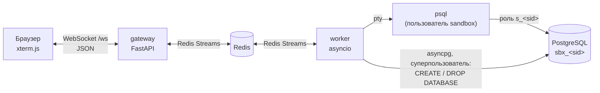
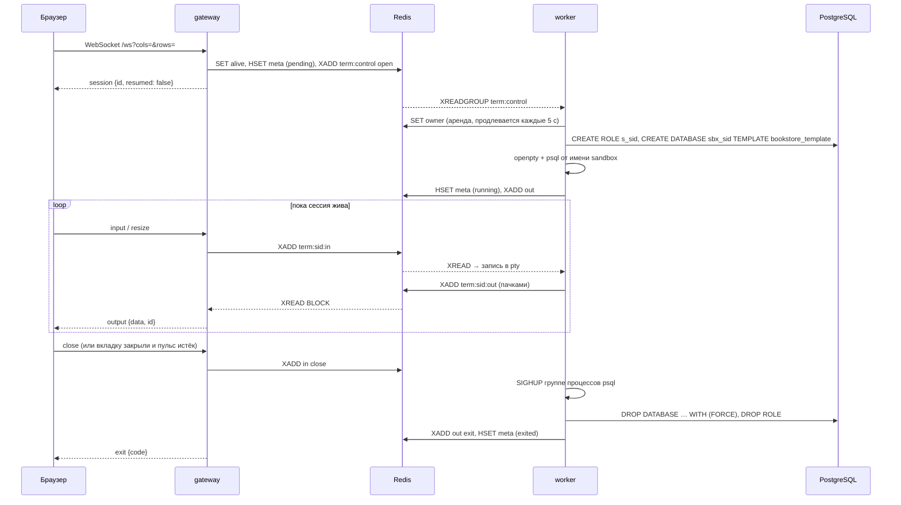

# Архитектура

| Компонент | Код | Что делает |
|---|---|---|
| gateway | [`webpsql/gateway.py`](../webpsql/gateway.py) | Отдаёт страницы, держит WebSocket, проверяет сообщения браузера моделями из [`protocol.py`](../webpsql/protocol.py), перекладывает их в Redis и обратно. Терминалов не запускает и состояния в памяти не хранит. |
| worker | [`webpsql/worker.py`](../webpsql/worker.py) | Берёт заявки на сессии, создаёт копию базы ([`sandbox.py`](../webpsql/sandbox.py)), запускает psql в pty, читает его вывод неблокирующе через event loop. |
| Redis | — | Шина между gateway и worker'ами и хранилище состояния сессий. |
| PostgreSQL | [`db/`](../db/) | Шаблон `bookstore_template` и по одной копии на сессию. |

Worker никого не слушает: он сам подключается к Redis и PostgreSQL. Его можно держать
рядом с базой, за файрволом, не открывая наружу ни одного порта.

## Ключи Redis

| Ключ | Тип | Кто пишет → кто читает | Что внутри |
|---|---|---|---|
| `term:control` | stream | gateway → worker | заявки `open` (consumer group `workers`) |
| `term:{sid}:in` | stream | gateway → worker | `input`, `resize`, `close` |
| `term:{sid}:out` | stream | worker → gateway | `output`, `error`, `exit` |
| `term:{sid}:alive` | string, TTL 60 с | gateway | пульс браузера |
| `term:{sid}:owner` | string, TTL 15 с | worker | аренда: worker жив и держит psql |
| `term:{sid}:meta` | hash | gateway и worker | статус, worker, PID, копия базы, время её создания, окно, число вкладок |

Типы сообщений (`Kind`) и статусы сессии (`SessionStatus`) перечислены в
[`webpsql/streams.py`](../webpsql/streams.py).

## Жизнь сессии

## Переподключение

Каждое сообщение `output` несёт `id` — позицию в потоке `term:{sid}:out`. Браузер хранит
`session` и последний `id` в `sessionStorage`:

- **обрыв связи** — переподключается с `?session=…&last=<id>` и получает только пропущенное;
- **перезагрузка страницы** — экран пуст, поэтому просит поток с начала (`last=0-0`)
  и восстанавливает всё, что было на экране;
- **вкладку закрыли** — gateway перестаёт продлевать `alive`; через 60 секунд worker
  завершает psql и удаляет копию базы.

psql при переподключении не перезапускается, незакоммиченная транзакция остаётся открытой.

## Если worker упал

Worker продлевает `term:{sid}:owner` каждые 5 секунд с TTL 15 секунд. Если ключ исчез,
а сессия числится `running`:

- gateway помечает её `lost` и отправляет браузеру `error` + `exit` (проверено: `docker compose kill worker` —
  браузер узнаёт через ~12 секунд);
- сборщик мусора любого worker'а (раз в минуту и при старте) удаляет базы `sbx_*`
  и роли `s_*`, у которых нет аренды.

## Протокол WebSocket `/ws`

JSON-сообщения с полем `type`. Каждый тип описан Pydantic-моделью в
[`webpsql/protocol.py`](../webpsql/protocol.py); входящие разбираются по `type`
(discriminated union), так что сообщение неизвестного типа или с неверными полями
отбрасывается, а браузер получает `error`.

| Направление | `type` | Поля |
|---|---|---|
| браузер → сервер | `input` | `data` — символы от xterm.js, до 64 КБ |
| браузер → сервер | `resize` | `cols`, `rows` (2…1000) |
| браузер → сервер | `close` | — |
| сервер → браузер | `session` | `id`, `resumed` |
| сервер → браузер | `output` | `data`, `id` — позиция в потоке Redis |
| сервер → браузер | `error` | `message` |
| сервер → браузер | `exit` | `code` (отрицательный — psql остановлен сигналом или не запускался) |

Параметры подключения: `?cols=&rows=` для новой сессии, `?session=<id>&last=<id>` —
вернуться к работающей. Ресайз браузер отправляет не чаще раза в 200 мс.

## HTTP

Swagger — <http://localhost:8000/docs>.

| Метод | Что возвращает |
|---|---|
| `GET /api/sessions` | все сессии, сначала новые; завершённые видны ещё 5 минут |
| `GET /api/sessions/{id}` | одна сессия, `404` если её нет |
| `GET /healthz` | `{"redis": true}`, если gateway видит Redis |

## Настройки

| Переменная | По умолчанию | Кто читает | Назначение |
|---|---|---|---|
| `REDIS_URL` | `redis://localhost:6379/0` | оба | адрес Redis |
| `ADMIN_DSN` | `postgresql://postgres@localhost/postgres` | worker | суперпользователь для CREATE/DROP DATABASE |
| `PG_HOST`, `PG_PORT` | `localhost`, `5432` | worker | куда подключается psql |
| `PSQL_CMD` | `psql` | worker | команда в терминале |
| `SANDBOX_USER` | — | worker | пользователь ОС для psql; пусто — от имени worker'а |
| `SANDBOX_NPROC` | `256` | worker | лимит процессов пользователя `sandbox` |
| `MAX_SESSIONS` | `10` | worker | сколько терминалов держит один worker |
| `HEARTBEAT_TTL` | `60` | оба | сколько секунд ждать браузер после обрыва связи |
| `STREAM_MAXLEN` | `2000` | worker | сколько кусков вывода хранить для переподключения |

В `docker-compose.yml` пароли берутся из `POSTGRES_PASSWORD` и `REDIS_PASSWORD`
(файл `.env`), по умолчанию — `web-psql`.
