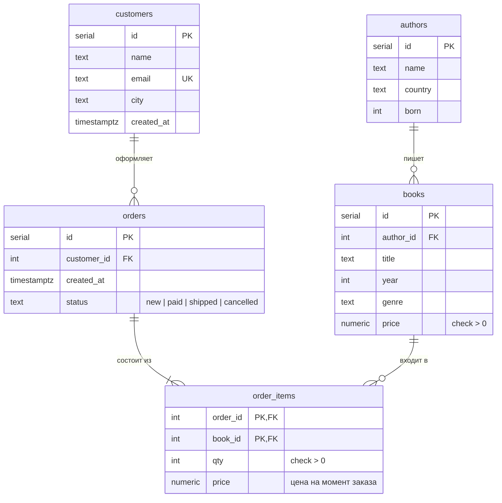

# Учебная база `bookstore`

Книжный магазин: авторы, книги, покупатели, заказы. Данных достаточно, чтобы
`EXPLAIN ANALYZE`, индексы и агрегаты показывали что-то осмысленное, и мало, чтобы
копия базы создавалась за десятки миллисекунд (шаблон весит ~9 МБ).



| Таблица | Строк | Индексы, кроме PK |
|---|---:|---|
| `authors` | 15 | — |
| `books` | 30 | `author_id`, `genre` |
| `customers` | 500 | `email` (unique) |
| `orders` | 5 000 | `customer_id`, `created_at` |
| `order_items` | ~10 000 | — |

Представление `top_authors` — десять авторов с наибольшей выручкой без учёта отменённых заказов.

## Откуда берутся данные

- [`db/sql/schema.sql`](../db/sql/schema.sql) — таблицы, индексы, представление, комментарии.
- [`db/sql/data.sql`](../db/sql/data.sql) — 45 строк справочников вручную, остальное
  `generate_series` + `random()` с `setseed(0.42)`: у всех получается одна и та же база.
- [`db/init/00-sandbox-template.sql`](../db/init/00-sandbox-template.sql) выполняется при
  первом старте контейнера: создаёт роль `sandbox_owner` и базу `bookstore_template`,
  заливает в неё схему и данные от имени `sandbox_owner` и помечает базу шаблоном
  (`is_template`, `allow_connections false`).

Пересоздать шаблон после правок SQL: `docker compose down -v && docker compose up --build`.

## Что попробовать

```sql
\dt+                                         -- таблицы и их размеры
\d+ orders                                   -- столбцы, индексы, ограничения
select * from top_authors;
explain analyze select * from orders where customer_id = 42;   -- Index Scan
explain analyze select * from orders where status = 'new';     -- Seq Scan: индекса нет
create index on orders(status);                                -- и снова explain
begin; delete from order_items; rollback;                      -- транзакции
drop table books cascade;                                      -- можно: это ваша копия
```
