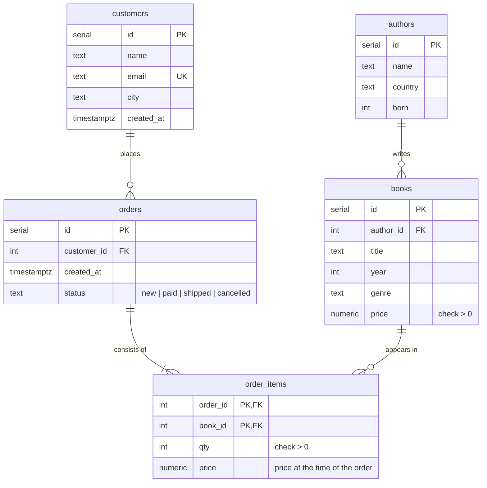

# The `bookstore` demo database

A bookstore: authors, books, customers, orders. There is enough data to make query plans,
indexes and totals interesting, and little enough — the database is about 9 MB — that a copy is
created in tens of milliseconds.



| Table | Rows | Indexes besides the primary key |
|---|---:|---|
| `authors` | 15 | — |
| `books` | 30 | `author_id`, `genre` |
| `customers` | 500 | `email` (unique) |
| `orders` | 5,000 | `customer_id`, `created_at` |
| `order_items` | ~10,000 | — |

The `top_authors` view lists the ten authors with the highest revenue, cancelled orders excluded.

## Where the data comes from

- [`db/sql/schema.sql`](../db/sql/schema.sql) — tables, indexes, the view and table descriptions.
- [`db/sql/data.sql`](../db/sql/data.sql) — authors and books are written by hand, customers and
  orders are generated randomly. The generator always starts from the same seed, so everyone
  gets the same database.
- [`db/init/00-sandbox-template.sql`](../db/init/00-sandbox-template.sql) runs on the first
  PostgreSQL start: it creates the `bookstore_template` database, loads the tables and data into
  it and turns it into the template the worker copies for every session. How the permissions
  work is in [sandbox.md](sandbox.md).

If you change the SQL files, recreate the database: `docker compose down -v && docker compose up --build`.

## Things to try

```sql
\dt+                                         -- tables and their sizes
\d+ orders                                   -- columns, indexes, constraints
select * from top_authors;
explain analyze select * from orders where customer_id = 42;   -- Index Scan: lookup by index
explain analyze select * from orders where status = 'new';     -- Seq Scan: no index, the whole table is read
create index on orders(status);                                -- create an index and compare again
begin; delete from order_items; rollback;                      -- delete, then change your mind
drop table books cascade;                                      -- go ahead: it is your copy
```
