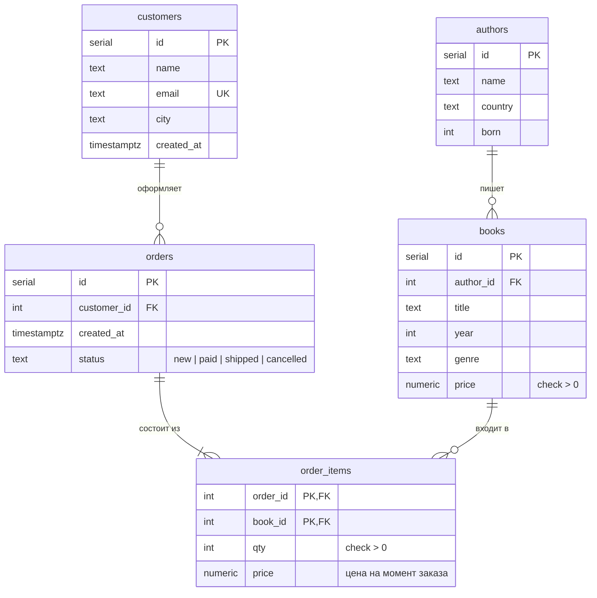

# Учебная база `bookstore`

Книжный магазин: авторы, книги, покупатели, заказы. Данных достаточно, чтобы на них было
интересно смотреть планы запросов, пробовать индексы и считать итоги, и при этом мало —
база весит около 9 МБ, поэтому её копия создаётся за десятки миллисекунд.



| Таблица | Строк | Индексы, кроме PK |
|---|---:|---|
| `authors` | 15 | — |
| `books` | 30 | `author_id`, `genre` |
| `customers` | 500 | `email` (unique) |
| `orders` | 5 000 | `customer_id`, `created_at` |
| `order_items` | ~10 000 | — |

Представление `top_authors` — десять авторов с наибольшей выручкой без учёта отменённых заказов.

## Откуда берутся данные

- [`db/sql/schema.sql`](../db/sql/schema.sql) — таблицы, индексы, представление и описания таблиц.
- [`db/sql/data.sql`](../db/sql/data.sql) — авторы и книги записаны вручную, покупатели и заказы
  генерируются случайно. Генератор каждый раз запускается с одним и тем же начальным значением,
  поэтому у всех получается одна и та же база.
- [`db/init/00-sandbox-template.sql`](../db/init/00-sandbox-template.sql) выполняется при
  первом запуске PostgreSQL: создаёт базу `bookstore_template`, заливает в неё таблицы и данные
  и делает её шаблоном, из которого worker копирует базу для каждой сессии.
  Как устроены права — в [sandbox.md](sandbox.md).

Если поменяли SQL-файлы, пересоздайте базу: `docker compose down -v && docker compose up --build`.

## Что попробовать

```sql
\dt+                                         -- таблицы и их размеры
\d+ orders                                   -- столбцы, индексы, ограничения
select * from top_authors;
explain analyze select * from orders where customer_id = 42;   -- Index Scan: поиск по индексу
explain analyze select * from orders where status = 'new';     -- Seq Scan: индекса нет, читается вся таблица
create index on orders(status);                                -- создать индекс и снова сравнить
begin; delete from order_items; rollback;                      -- удалить и передумать
drop table books cascade;                                      -- можно: это ваша копия
```
